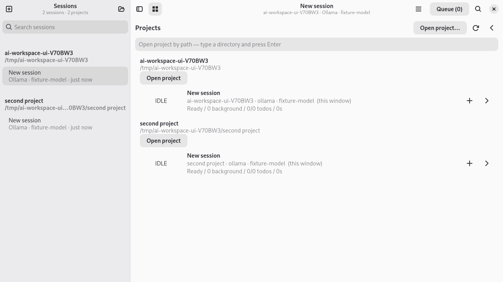
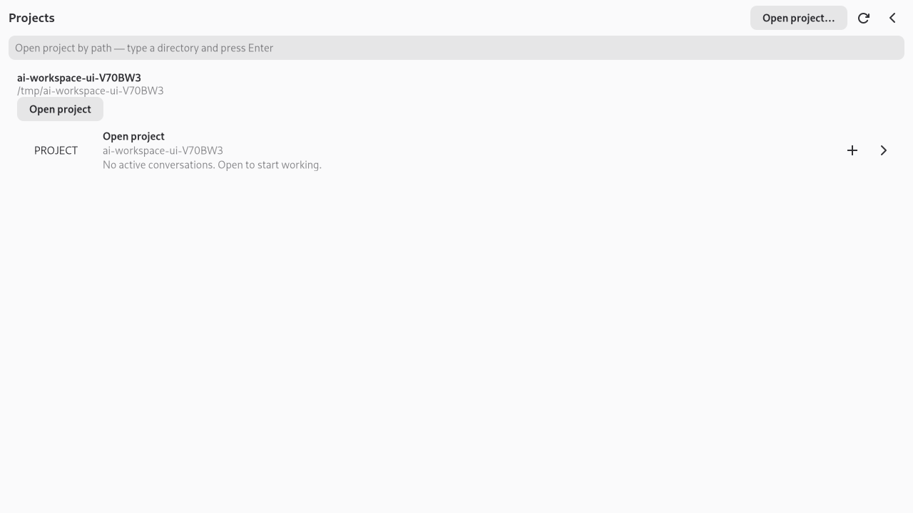
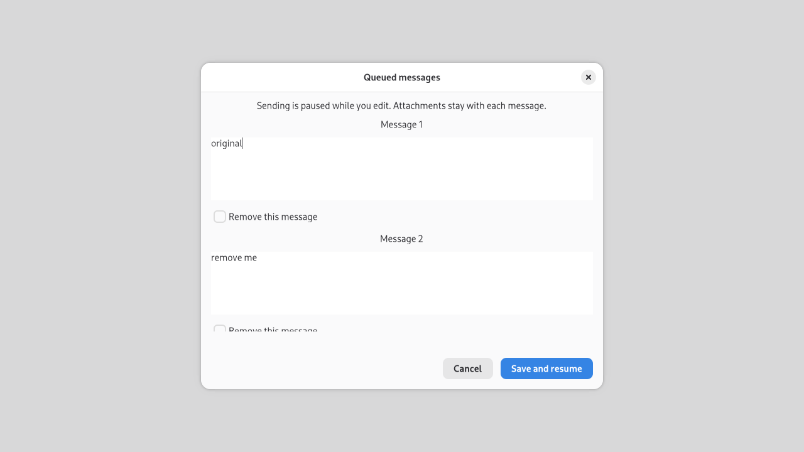

#+title: Project workspaces and queued-message editing

These artifacts come from the built C frontends, using isolated directories,
private tmux servers and scripted providers. Trailing whitespace is trimmed from
the terminal log. These are not mockups. GTK captures
use a headless Wayland compositor; no real model request is submitted. The GTK
fixture sets its model explicitly and points Ollama discovery at a closed local
port. Tests assert the resulting session identities and submitted messages,
beyond the visual captures.

* Desktop

The widget tests open a project by its button and path field, retain the same
focused row/button across an unchanged refresh, then exercise the full application
window: opening a second directory creates a second conversation, reopening
either directory keeps the count at two. The queue test pauses dispatch, rejects
an empty edit without applying a removal, saves a multiline edit and removes the
second entry, then checks the mock provider received only the edited text.
Cancel is checked separately and submits the original text.

* Terminal

[[file:project-workspace/tmux-workflows.txt][Verbatim tmux captures and assertions]] cover:

- Startup dashboard path entry, including directory names with spaces.
- New project workers, collision handling, and multiple workers as windows in
  one project session.
- Reusing the same project session after it is renamed.
- =/cwd= across projects opening a separate session.
- Queue list and full-message editor, retaining an unsent draft while the active
  reply finishes, then submitting the edited message.
- Repairing an inherited =WORK: DONE: WORK:= prefix to one status prefix.
- Existing assignment, worktree, title opt-out and native recovery behavior.

* Reproduction

Build with =make -j8 all tests=. The ordinary =make test= runs the core and tmux
regressions; GTK widget tests explicitly skip without =AI_GUI_UI_TEST=1= and a
display. =make test-gi= additionally checks the new queue APIs through Python.
For captures, from the repository root:

#+begin_src sh
AI_TUI_DEMONSTRATE=1 G_DEBUG=fatal-warnings \
  build/release/tests/test-tui-dashboard > /tmp/tmux-workflows.txt

mkdir -p /tmp/ai-workspace-captures
WLR_BACKENDS=headless WLR_RENDERER=pixman \
AI_GUI_UI_TEST=1 AI_GUI_DEMONSTRATE=/tmp/ai-workspace-captures \
GSK_RENDERER=cairo G_DEBUG=fatal-warnings \
  cage -- build/release/tests/test-ai-gui-workspace-ui
#+end_src

The second command requires Cage and its wlroots headless backend. On a desktop,
run the test directly with =AI_GUI_UI_TEST=1= using the existing GTK display.
Temporary paths, random test seeds and timestamps naturally vary. Every reported
case must pass; a picture alone does not establish dispatch or ownership behavior.
